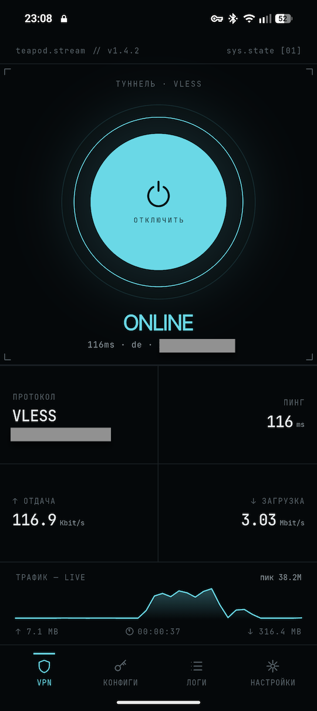
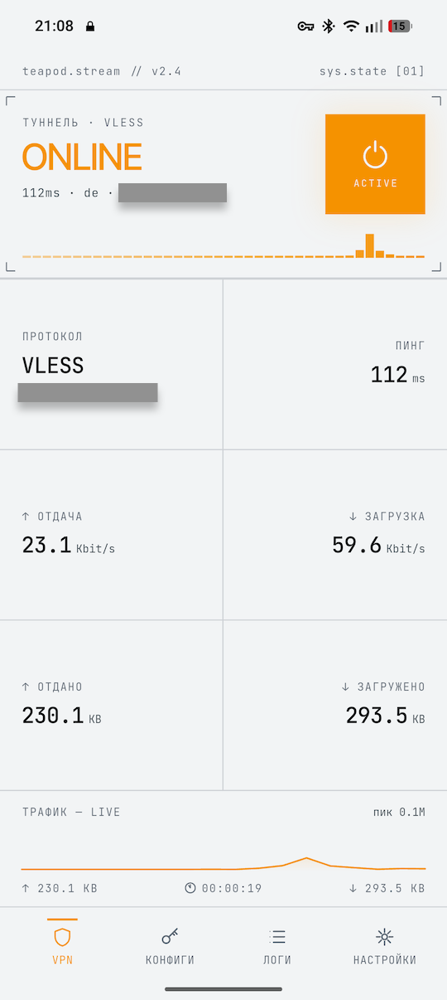

# TeapodStream

[Русский](README.md) | **English**

An Android VPN client built on Xray-core, sing-box and xray-rust, with a TUN interface.

> [!WARNING]
> To avoid misunderstandings, a short note on what this project is and where it's going
>
> Teapod Stream is a personal non-commercial project whose main goal is simplicity. It's not a geek's Swiss army knife with a hundred settings, just a convenient "human" UI for a VPN.
>
> The client evolves as needed: the code gets polished when the author runs into bugs or quirks himself.
> - Priorities: the project is still building up its core features, so minor bugs are fixed last.
> - Releases: stable builds the author has already tested on himself.
> - Pre-releases: versions under active development (anything may change or break).

 

## Features

- **Three cores** — Xray-core (Go), sing-box and xray-rust (experimental). A profile runs on the first core in the priority list that supports it; a core can be pinned to a profile or disabled
- **Protocols:** VLESS (XTLS Vision, Reality), VMess, Trojan, Shadowsocks (including 2022), Hysteria2 (port hopping, Salamander); sing-box only: **WireGuard**, **AmneziaWG 3.1**, **SSH**, **NaiveProxy**
- **Transports:** TCP/RAW, WebSocket, gRPC, xHTTP/SplitHTTP, HTTPUpgrade; HTTP/2 and QUIC — sing-box only (removed from Xray-core)
- **Security:** TLS (uTLS fingerprint, ECH, certificate pinning `pinSHA256`), Reality (including post-quantum ML-DSA-65)
- **Import:** links, QR codes, clipboard, WireGuard `.conf`, AmneziaVPN `vpn://` keys, `teapod://` deeplinks for settings profiles and connection bundles
- **Subscriptions:** base64 / plain text / JSON, scheduled auto-refresh, HWID, custom User-Agent, self-signed certificates (trust on first use)
- **Routing:** Global / Bypass / Only modes; geoip, geosite, domain zones and sites, a Russian services preset, ad blocking, LAN bypass, SNI sniffing
- **Split tunneling** — include or exclude specific apps; optional hotspot tethering through the VPN
- **Kill switch**, auto-connect on launch and on device boot, automatic reconnect on network change (Wi-Fi ↔ LTE)
- **Tunnel health check** (Doze-aware): reconnect to the same server or switch to the fastest live config
- **DPI bypass:** TCP fragmentation, UDP noise, Mux, Shadowsocks prefix (`?prefix=`, Outline)
- **DNS:** through the VPN or direct; Cloudflare / Google / Quad9 / AdGuard presets over UDP, DoH and DoT, or a custom server
- **Proxy-only mode** — a SOCKS5 proxy without a TUN tunnel
- **Settings profiles** — switching, export/import, read-only lock
- Quick Settings tile, a notification with speed, Tasker/Anubis automation
- Live traffic chart and logs, in-app updates from GitHub Releases (stable or pre-release channel)
- **Languages:** English and Russian — follows the system language, switchable in Settings → appearance

## Architecture

TUN mode (default), Go core and sing-box:
```
[Apps] → [TUN interface] → [teapod-tun2socks] → [SOCKS5 127.0.0.1:port] → [xray-core | sing-box] → [Server]
```

TUN mode, xray-rust core (reads TUN itself):
```
[Apps] → [TUN interface] → [xray-rust] → [Server]
```

Proxy-only mode:
```
[App] → [SOCKS5 127.0.0.1:port] → [xray-core | sing-box] → [Server]
```

- **[teapod-core](https://github.com/Wendor/teapod-core)** — AAR with the cores: xray-core, sing-box, xray-rust and teapod-tun2socks
- **[teapod-tun2socks](https://github.com/Wendor/teapod-tun2socks)** — bridge between the TUN interface and the core's SOCKS5 (gVisor netstack)
- **Android VpnService** — manages the TUN interface at the OS level
- **Flutter** — UI and settings (Riverpod), localization via `gen_l10n` (`lib/l10n/*.arb`)

## Settings

### Connection

| Setting | Default | Description |
|---|---|---|
| Auto-connect | off | Connect when the app starts |
| Start on boot | off | Connect after the device reboots |
| Kill switch | off | Block traffic when the VPN drops |
| Proxy only | off | SOCKS5 without a VPN tunnel (no VPN permission needed) |
| Split tunneling | off | Include/exclude specific apps |
| Automation | off | Tasker/Anubis CONNECT/DISCONNECT commands and state broadcasts |

### SOCKS5

| Setting | Default | Description |
|---|---|---|
| Random port | on | A random SOCKS5 port on every connection |
| SOCKS5 port | 10808 | A fixed port (when random is off) |
| Random credentials | on | Generate a login/password on every connection |
| Login / Password | — | Fixed credentials (in TUN mode empty ones are replaced with random) |
| UDP | on | Pass UDP traffic through SOCKS |

### DNS

| Setting | Default | Description |
|---|---|---|
| DNS mode | via VPN | `via VPN` — resolved by the core's DNS module; `direct` — the system resolver |
| Server | Cloudflare (UDP) | Presets over UDP / DoH / DoT or a custom server |
| Strategy | IPv4 only | IP version for DNS queries |
| Block QUIC | off | Reject UDP/443 so browsers use TCP right away |

### Subscriptions

- base64, plain text and JSON formats
- Self-signed TLS certificates: the app shows the certificate details and remembers the accepted one
- Scheduled auto-refresh (1–24 h interval)
- Default HTTP User-Agent: `TeapodStream/<version> (Android; XrayNG-compatible) Xray-core/<version>`

## Building

```bash
# Download binary dependencies (teapod-core.aar + geodata)
./build.sh binaries

# Build and run on a connected device
./build.sh run          # debug
./build.sh run-release  # release

# Build only
./build.sh debug    # debug APK
./build.sh release  # release APK (split-per-ABI)
./build.sh aab      # AAB for Google Play

./build.sh clean
```

### Requirements

- Flutter SDK (Dart SDK 3.11+)
- Android SDK
- Java 21+

### Dependencies

Binaries are downloaded by `./build.sh binaries`:
- [teapod-core](https://github.com/Wendor/teapod-core) — strictly the version from `pubspec.yaml`
- [geoip.dat / geosite.dat](https://github.com/Loyalsoldier/v2ray-rules-dat)

### Translations

UI strings live in `lib/l10n/app_en.arb` (template) and `lib/l10n/app_ru.arb`; Dart classes are generated by `flutter gen-l10n` (and automatically on `flutter pub get` / build). Native notification and tile texts are in `android/app/src/main/res/values*/strings.xml`. To add a language, add `app_<code>.arb` and `values-<code>/strings.xml`.

## Testing

```bash
flutter analyze
flutter test                                      # Dart: models, services, providers, protocols, screens
cd android && ./gradlew :app:testDebugUnitTest    # JVM tests for Kotlin
dart run tool/itest/main.dart --help              # on-device integration tests
```

## Contributing

Pull requests are welcome — read [CONTRIBUTING.md](CONTRIBUTING.md) first (AI-assisted ones too: [AGENTS.md](AGENTS.md)). How the app works inside: [wiki](wiki/index.md).

## Supported architectures

- `arm64-v8a`
- `x86_64`

## License

[MIT](LICENSE). Open-source components used:
- [Xray-core](https://github.com/XTLS/Xray-core) — MPL-2.0
- [sing-box](https://github.com/SagerNet/sing-box) — GPL-3.0-or-later
- [amneziawg-go](https://github.com/amnezia-vpn/amneziawg-go) — MIT
- [teapod-tun2socks](https://github.com/Wendor/teapod-tun2socks) — MIT
