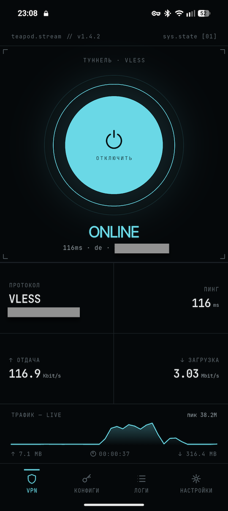
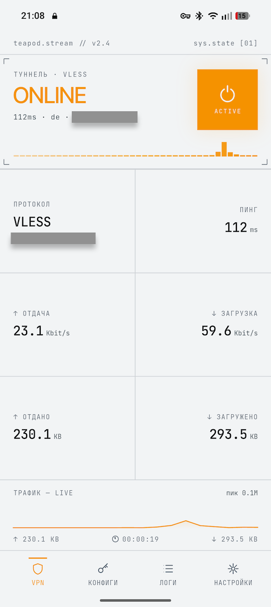

# TeapodStream

**Русский** | [English](README.en.md)

VPN-клиент для Android на ядрах Xray-core, sing-box и xray-rust с интерфейсом TUN.

> [!WARNING]
> Во избежание недопониманий, коротко о сути проекта и планах
>
> Teapod Stream — это личный некоммерческий проект, главная цель которого — простота. Это не комбайн для гиков с сотней настроек, а просто удобный «человеческий» UI для VPN.
>
> Развитие клиента происходит по мере необходимости: код допиливается, когда автор сам сталкивается с какими-то багами или нюансами.
> - Приоритеты: проект на стадии набора базового функционала, поэтому минорные баги правятся в последнюю очередь.
> - Releases: здесь лежат стабильные сборки, которые автор уже обкатал на себе.
> - Pre-releases: активно разрабатываемые версии (всё может меняться и ломаться).

 

## Возможности

- **Три ядра** — Xray-core (Go), sing-box и xray-rust (экспериментальное). Профиль запускает первое по приоритету ядро, которое его поддерживает; ядро можно закрепить за профилем или выключить
- **Протоколы:** VLESS (XTLS Vision, Reality), VMess, Trojan, Shadowsocks (включая 2022), Hysteria2 (port hopping, Salamander); только на sing-box: **WireGuard**, **AmneziaWG 3.1**, **SSH**, **NaiveProxy**
- **Транспорты:** TCP/RAW, WebSocket, gRPC, xHTTP/SplitHTTP, HTTPUpgrade; HTTP/2 и QUIC — только на sing-box (удалены из Xray-core)
- **Безопасность:** TLS (uTLS fingerprint, ECH, пин сертификата `pinSHA256`), Reality (включая post-quantum ML-DSA-65)
- **Импорт:** ссылки, QR-коды, буфер обмена, `.conf` WireGuard, ключи AmneziaVPN `vpn://`, диплинки `teapod://` для профилей настроек и наборов подключений
- **Подписки:** base64 / plain text / JSON, автообновление по расписанию, HWID, свой User-Agent, самоподписанные сертификаты (доверие при первом подключении)
- **Маршрутизация:** режимы «Весь трафик» / «Обход» / «Только»; geoip, geosite, доменные зоны и сайты, пресет российских сервисов, блокировка рекламы, обход локальных сетей, снифинг SNI
- **Раздельное туннелирование** — включение или исключение конкретных приложений; опционально раздача точки доступа через VPN
- **Kill switch**, автоподключение при запуске и после перезагрузки, авто-переподключение при смене сети (Wi-Fi ↔ LTE)
- **Проверка живости туннеля** (с учётом Doze): переподключение к тому же серверу или переход на самый быстрый живой конфиг
- **Обход DPI:** фрагментация TCP, UDP-шумы, Mux, префикс Shadowsocks (`?prefix=`, Outline)
- **DNS:** через VPN или напрямую; пресеты Cloudflare / Google / Quad9 / AdGuard по UDP, DoH и DoT или свой сервер
- **Режим «только прокси»** — SOCKS5-прокси без TUN-туннеля
- **Профили настроек** — переключение, экспорт/импорт, блокировка от изменений
- Плитка быстрых настроек, уведомление со скоростью, автоматизация Tasker/Anubis
- График трафика в реальном времени и логи, обновление приложения из GitHub Releases (стабильный канал или pre-release)
- **Языки:** русский и английский — по языку системы, переключается в Настройки → appearance

## Архитектура

Режим TUN (по умолчанию), ядра Go и sing-box:
```
[Приложения] → [TUN-интерфейс] → [teapod-tun2socks] → [SOCKS5 127.0.0.1:port] → [xray-core | sing-box] → [Сервер]
```

Режим TUN, ядро xray-rust (читает TUN само):
```
[Приложения] → [TUN-интерфейс] → [xray-rust] → [Сервер]
```

Режим «только прокси»:
```
[Приложение] → [SOCKS5 127.0.0.1:port] → [xray-core | sing-box] → [Сервер]
```

- **[core/](core/)** — AAR teapod-core с ядрами: xray-core, sing-box, xray-rust и teapod-tun2socks
- **[core/tun2socks/](core/tun2socks/)** — мост между TUN-интерфейсом и SOCKS5 ядра (gVisor netstack)
- **Android VpnService** — управление TUN-интерфейсом на уровне ОС
- **Flutter** — UI и настройки (Riverpod), локализация через `gen_l10n` (`lib/l10n/*.arb`)

## Настройки

### Подключение

| Параметр | По умолчанию | Описание |
|---|---|---|
| Автоподключение | выкл | Подключаться при запуске приложения |
| Запуск при загрузке | выкл | Подключаться после перезагрузки устройства |
| Kill switch | выкл | Блокировать трафик при разрыве VPN |
| Только прокси | выкл | SOCKS5 без VPN-туннеля (разрешения VPN не требуется) |
| Раздельное туннелирование | выкл | Включить/исключить конкретные приложения |
| Автоматизация | выкл | Команды CONNECT/DISCONNECT и рассылка состояния для Tasker/Anubis |

### SOCKS5

| Параметр | По умолчанию | Описание |
|---|---|---|
| Случайный порт | вкл | Случайный SOCKS5-порт при каждом подключении |
| SOCKS5 порт | 10808 | Фиксированный порт (когда случайный выкл) |
| Случайные учётные данные | вкл | Генерировать логин/пароль при каждом подключении |
| Логин / Пароль | — | Фиксированные учётные данные (в режиме TUN пустые заменяются случайными) |
| UDP | вкл | Пропускать UDP-трафик через SOCKS |

### DNS

| Параметр | По умолчанию | Описание |
|---|---|---|
| Режим DNS | через VPN | `через VPN` — резолв DNS-модулем ядра; `напрямую` — системный резолвер |
| Сервер | Cloudflare (UDP) | Пресеты по UDP / DoH / DoT или свой сервер |
| Стратегия | только IPv4 | IP-версия для DNS-запросов |
| Блокировать QUIC | выкл | Отбивать UDP/443, чтобы браузеры сразу шли по TCP |

### Подписки

- Форматы base64, plain text и JSON
- Самоподписанные TLS-сертификаты: приложение показывает данные сертификата и запоминает принятый
- Автообновление по расписанию (интервал 1–24 ч)
- HTTP User-Agent по умолчанию: `TeapodStream/<версия> (Android; XrayNG-compatible) Xray-core/<версия>`

## Сборка

```bash
# Скачать бинарные зависимости (teapod-core.aar + geodata)
./build.sh binaries

# Сборка и запуск на подключённом устройстве
./build.sh run          # debug
./build.sh run-release  # release

# Только сборка
./build.sh debug    # debug APK
./build.sh release  # release APK (split-per-ABI)
./build.sh aab      # AAB для Google Play

./build.sh clean
```

### Требования

- Flutter SDK (Dart SDK 3.11+)
- Android SDK
- Java 21+

### Зависимости

Бинарные файлы загружаются командой `./build.sh binaries`:
- teapod-core — AAR для текущего `core/` (скачивается из релиза с теми же исходниками, иначе собирается: `./build.sh core`)
- [geoip.dat / geosite.dat](https://github.com/Loyalsoldier/v2ray-rules-dat)

### Переводы

Строки интерфейса — в `lib/l10n/app_en.arb` (шаблон) и `lib/l10n/app_ru.arb`; Dart-классы генерирует `flutter gen-l10n` (и автоматически при `flutter pub get` / сборке). Тексты нативных уведомлений и плитки — в `android/app/src/main/res/values*/strings.xml`. Новый язык — это `app_<код>.arb` и `values-<код>/strings.xml`.

## Тестирование

```bash
flutter analyze
flutter test                                      # Dart: модели, сервисы, провайдеры, протоколы, экраны
cd android && ./gradlew :app:testDebugUnitTest    # JVM-тесты Kotlin
dart run tool/itest/main.dart --help              # интеграционные тесты на устройстве
```

## Участие в разработке

Pull request'ы приветствуются — сначала прочитайте [CONTRIBUTING.md](CONTRIBUTING.md) (написанные с ИИ тоже: [AGENTS.md](AGENTS.md)). Как устроено приложение: [wiki](wiki/index.md).

## Поддерживаемые архитектуры

- `arm64-v8a`
- `x86_64`

## Лицензия

[MIT](LICENSE). Используемые open-source компоненты:
- [Xray-core](https://github.com/XTLS/Xray-core) — MPL-2.0
- [sing-box](https://github.com/SagerNet/sing-box) — GPL-3.0-or-later
- [amneziawg-go](https://github.com/amnezia-vpn/amneziawg-go) — MIT
- [teapod-tun2socks](core/tun2socks/LICENSE) — MIT
